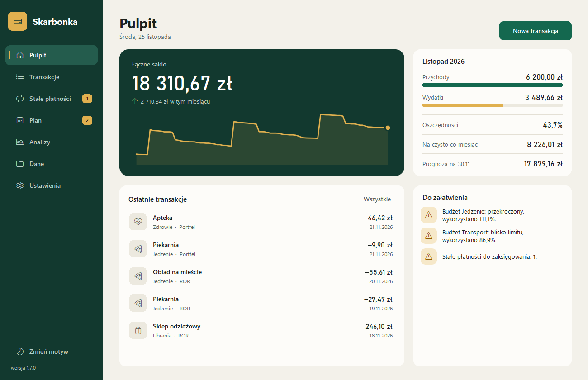
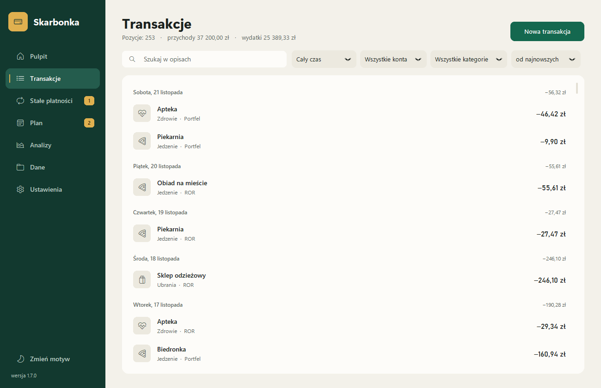
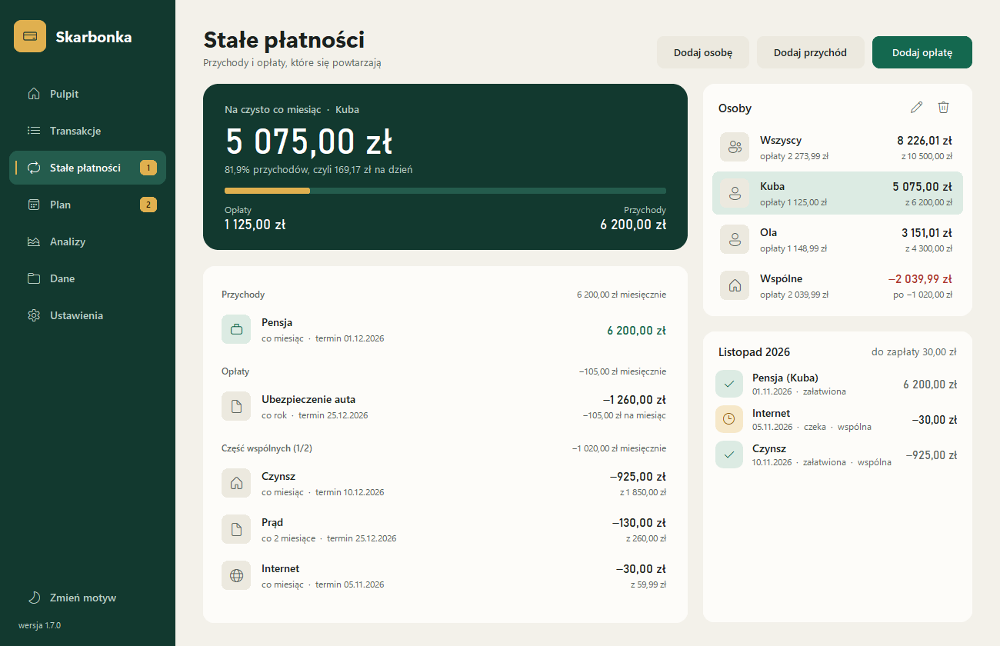
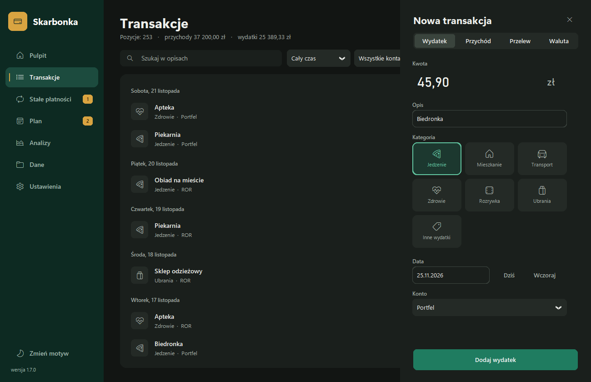
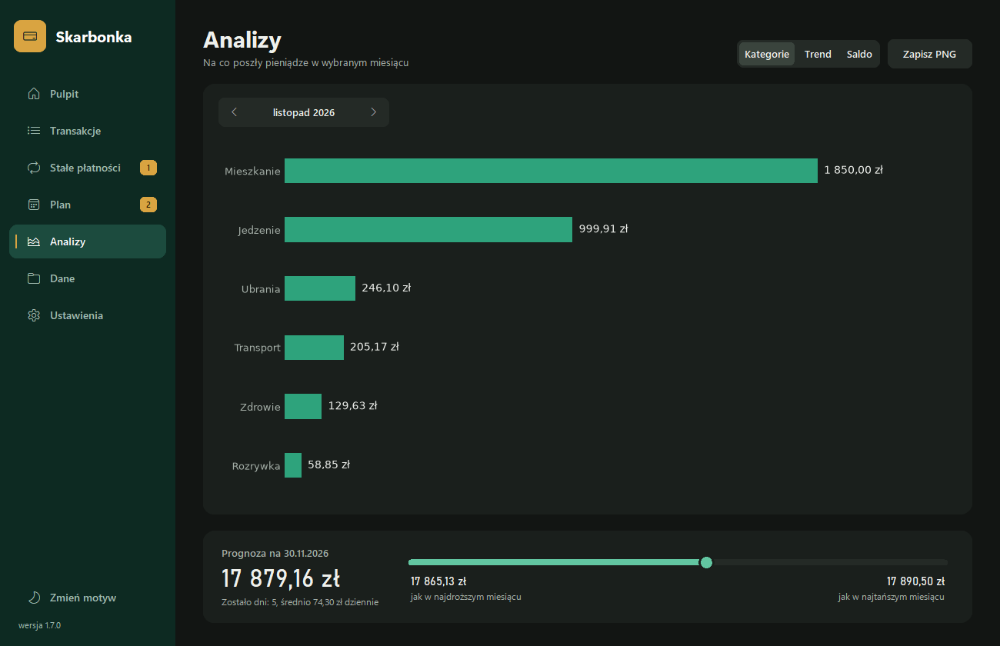
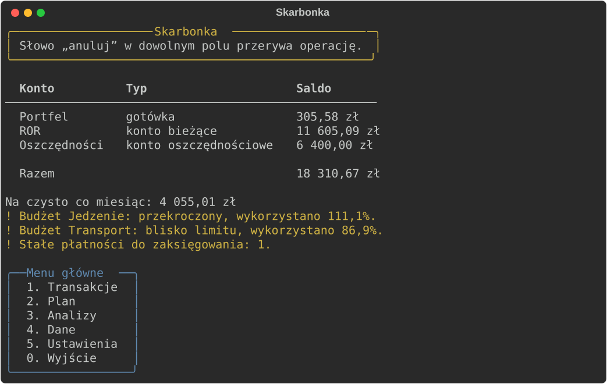
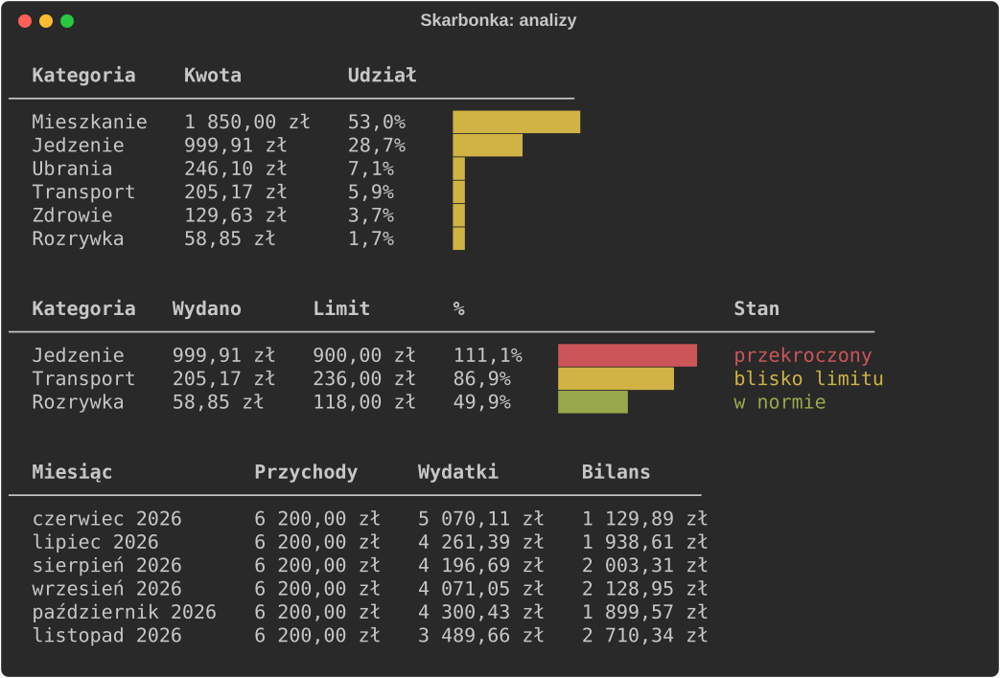
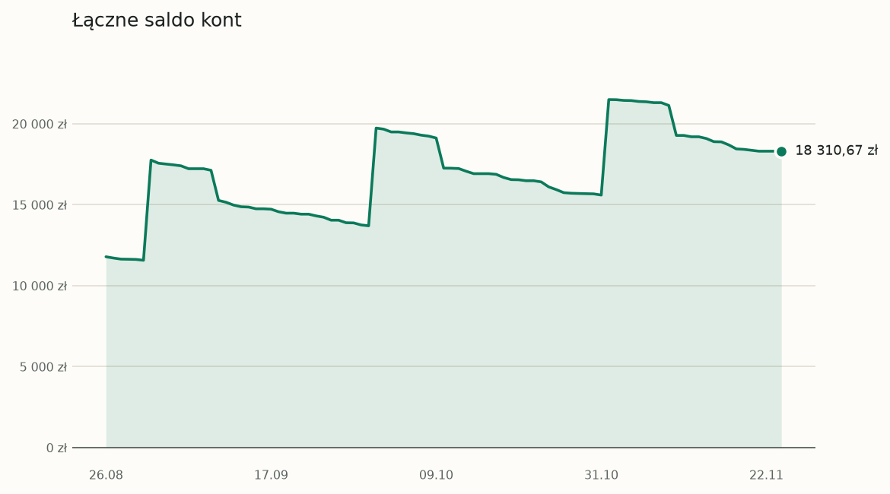

# Skarbonka

Menedżer budżetu domowego z dwoma interfejsami: w oknie i w konsoli. Zapisuje wydatki i przychody, pilnuje budżetów i celów, importuje wyciągi bankowe i prognozuje saldo na koniec miesiąca. Wszystkie dane zostają na komputerze użytkownika.













## Najważniejsze funkcje

- **Transakcje:** wydatki, przychody i przelewy między kontami, edycja, wyszukiwanie, wydatki w obcej walucie
- **Stałe płatności:** regularne przychody i opłaty (w dowolnym odstępie, np. co miesiąc, co 2 miesiące, co 30 dni), kwota, która zostaje na czysto, osobno dla każdej osoby i razem, kwoty stałe albo za każdym razem inne, terminy i księgowanie jednym kliknięciem
- **Plan:** budżety z ostrzeżeniami, cele oszczędnościowe
- **Analizy:** podsumowania, udziały kategorii, trend, prognoza salda w trzech wariantach, wykresy PNG
- **Dane:** import wyciągów CSV z wykrywaniem duplikatów, eksport CSV, raport TXT, kopie zapasowe JSON
- **Bezpieczeństwo:** każda dana wejściowa jest sprawdzana, błędy trafiają do logu, a uszkodzona baza jest odkładana i zastępowana kopią





Zrzuty pokazują dane wygenerowane przez tryb `--demo`.

## Instalacja

Wymagany jest Python 3.11 lub nowszy.

```powershell
git clone https://github.com/PSkrzyp11/skarbonka.git
cd skarbonka
python -m venv .venv
.venv\Scripts\python.exe -m pip install -r requirements.txt
```

Na systemach Linux i macOS zamiast `.venv\Scripts\python.exe` należy użyć `.venv/bin/python`.

## Uruchomienie

W konsoli:

```powershell
.venv\Scripts\python.exe main.py
```

W oknie:

```powershell
.venv\Scripts\python.exe main.py --okno
```

Jak zwykła aplikacja Windows (skrót na pulpicie i w menu Start oraz polecenia w każdym terminalu):

```powershell
.venv\Scripts\python.exe instaluj.py
```

Po instalacji działają polecenia `skarbonka` (okno) i `skarbonka-konsola`. Skróty i polecenia usuwa `instaluj.py --usun`; dane użytkownika zostają. Po przeniesieniu katalogu projektu trzeba uruchomić `instaluj.py` ponownie.

| Opcja | Działanie |
|---|---|
| `--okno` | interfejs okienkowy |
| `--demo` | osobna baza z przykładowymi danymi (`dane/demo`) |
| `--baza PLIK` | inny plik bazy danych |
| `--bez-kolorow` | wyłącza kolory |
| `--debug` | szczegółowe logi |
| `--wersja`, `--pomoc` | wersja i pomoc |

Testy:

```powershell
.venv\Scripts\python.exe -m pytest
```

## Menu w konsoli

| Menu | Opcje |
|---|---|
| 1. Transakcje | dodaj wydatek, dodaj przychód, przelew, wydatek w obcej walucie, lista, szukaj i filtruj, edytuj, usuń |
| 2. Plan | budżety (stan, limit, kopiowanie, usuwanie), cele (postęp, dodawanie, wpłaty, usuwanie), stałe przychody i opłaty (lista i kwota na czysto, płatności w tym miesiącu, dodawanie, edycja, księgowanie zaległych, wyłączanie, usuwanie, osoby) |
| 3. Analizy | saldo i sumy, podsumowanie miesiąca, kategorie, trend, największe wydatki, prognoza, wykresy PNG |
| 4. Dane | import CSV, cofnięcie importu, eksport CSV, raport TXT, utworzenie i przywrócenie kopii |
| 5. Ustawienia | konta, kategorie, reguły kategorii, profile CSV banków, próg ostrzeżeń |

`0` wraca do poprzedniego menu, a słowo `anuluj` przerywa wpisywanie w dowolnym polu. Wartość w nawiasie kwadratowym wstawia sam Enter.

Pliki do wypróbowania importu są w katalogu `przyklady`: poprawny `wyciag_demo.csv` i celowo błędny `wyciag_uszkodzony.csv`.

## Okno

| Widok | Co zawiera |
|---|---|
| Pulpit | saldo z wykresem, bieżący miesiąc, prognoza, ostatnie transakcje, sprawy do załatwienia |
| Transakcje | lista pogrupowana dniami, szukanie w trakcie pisania, filtry okresu, konta i kategorii, edycja (także dwuklikiem) i usuwanie |
| Stałe płatności | kwota na czysto co miesiąc, osoby i to, ile zostaje każdej z nich, lista stałych przychodów i opłat, terminy tego miesiąca z księgowaniem |
| Plan | budżety i cele z paskami postępu |
| Analizy | wykresy kategorii, trendu i salda, zapis do PNG, prognoza |
| Dane | import z podglądem i duplikatami, eksport, raport, kopie zapasowe |
| Ustawienia | konta, kategorie, reguły, profile CSV, próg ostrzeżeń |

Transakcje dodaje się w panelu wysuwanym z prawej: kategorię wybiera się kafelkiem z ikoną, a reguły podpowiadają ją w trakcie pisania opisu. Skróty: `Ctrl+N` nowa transakcja, `Ctrl+1` do `Ctrl+7` widoki, `Enter` zapis, `Esc` zamknięcie panelu. Motyw jasny lub ciemny jest zapamiętywany. Okno korzysta z tych samych serwisów i tej samej walidacji co konsola.

## Architektura

```
main.py                 uruchomienie, argumenty i wybór interfejsu
instaluj.py             skróty i polecenia Windows
skarbonka/
  config.py             stałe i ścieżki
  wyjatki.py            własne wyjątki
  demo.py               dane przykładowe
  models/               co przechowujemy: transakcje, konta, kategorie, plany
  services/             logika: salda, filtry, budżety, prognoza, import, raporty
  storage/              baza SQLite, pliki CSV i JSON
  ui/                   interfejs konsolowy: menu, ekrany, wczytywanie
  gui/                  interfejs okienkowy: widoki, panele, listy
  utils/                walidacja, formatowanie, daty, logi
tests/                  testy pytest
przyklady/              pliki CSV do importu
dane/                   baza, kopie, eksporty i logi użytkownika (poza repozytorium)
```

Zależności idą w jedną stronę: `ui` lub `gui -> services -> storage`, a z `models` korzystają wszystkie warstwy. Logika nie używa `input()`, dzięki czemu można ją testować bez klawiatury.

**Przechowywanie danych**

| Dane | Format | Miejsce |
|---|---|---|
| transakcje, konta, kategorie, plany, kursy | SQLite | `dane/skarbonka.db` |
| kopie zapasowe (także automatyczne, raz dziennie) | JSON | `dane/kopie` |
| ustawienia i profile banków | JSON | `dane` |
| import i eksport transakcji | CSV | `dane/eksport` lub dowolna ścieżka |
| raport miesiąca | TXT | `dane/raporty` |
| wykresy | PNG | `dane/wykresy` |
| logi | tekst z rotacją | `dane/logi` |

Kwoty są typu `Decimal`, a w bazie są zapisywane w groszach jako liczby całkowite, więc nie powstają błędy zaokrągleń.

**Jak powstaje kwota na czysto.** Każda aktywna stała pozycja jest przeliczana na jeden miesiąc: kwota jest mnożona przez liczbę powtórzeń w roku i dzielona przez 12, np. opłata co 2 miesiące liczy się w połowie. Od sumy stałych przychodów aplikacja odejmuje sumę stałych opłat. Opłata dodana do listy nie zmienia salda, dopóki nie zostanie zaksięgowana. Płatność zaksięgowana przed terminem dostaje dzisiejszą datę. Każda pozycja należy do jednej osoby albo jest wspólna. Wspólne dzielą się po równo: każda osoba widzi swoją część i ma ją odjętą od kwoty na czysto, a suma kwot osób zawsze równa się kwocie wszystkich; transakcja z pozycji osoby ma jej imię w opisie. Przy pozycji z kwotą zmienną, np. pensji godzinowej, aplikacja pyta o kwotę podczas księgowania; do bilansu wchodzi ostatnio wpisana, a na liście widać średnią z ostatnich 12.

**Jak powstaje prognoza.** Od dzisiejszego salda aplikacja odejmuje lub dodaje niezaksięgowane stałe płatności do końca miesiąca, a potem odejmuje dzienne tempo pozostałych wydatków pomnożone przez liczbę dni. Tempo pochodzi z trzech poprzednich miesięcy: średnia daje wariant realistyczny, najniższe optymistyczny, najwyższe pesymistyczny.

## Biblioteki

| Biblioteka | Po co |
|---|---|
| `rich` | tabele, ramki i kolory w terminalu |
| `customtkinter` | nowoczesny wygląd okna opartego na wbudowanym `tkinter` |
| `matplotlib` | wykresy w oknie i w plikach PNG |
| `pytest` | testy jednostkowe |

Z biblioteki standardowej między innymi: `sqlite3`, `csv`, `json`, `decimal`, `datetime`, `calendar`, `pathlib`, `logging`, `argparse`, `urllib`, `enum`, `dataclasses`, `abc`, `re`, `random`.

## Spełnienie wymagań

| Ocena | Wymaganie | Realizacja |
|---|---|---|
| 3.0 | dane od użytkownika i ich przetwarzanie | `ui/wejscie.py`, `services/` |
| 3.5 | menu wyboru przetwarzania danych | `ui/menu.py`, menu Analizy |
| 4.0 | funkcje wbudowane i własne, listy, słowniki | `services/analizy.py`, `services/transakcje.py` |
| 4.5 | własne moduły i biblioteka standardowa | sześć pakietów w `skarbonka` |
| 5.0 | zapis i odczyt pliku z menu, obsługa błędów | menu Dane, `storage/`, `wyjatki.py` |

| Element z zajęć | Gdzie w kodzie |
|---|---|
| `input()` i `print()` | `wczytaj` w `ui/wejscie.py`, `ui/widoki.py` |
| typy proste i złożone | `models/`; krotki i zbiory: `odcisk` w `models/transakcja.py`, `przygotuj` w `services/importer.py` |
| `if`, `match` | `stan` w `models/plan.py`, `termin` w `models/cykliczna.py` |
| `while`, `break`, `continue` | `uruchom` w `ui/menu.py`, `terminy` w `models/cykliczna.py` |
| `for`, `range()` | `trend` i `historia_salda` w `services/analizy.py` |
| `pass` | `_szukaj` w `services/waluty.py` |
| pliki tekstowe, CSV | `storage/pliki_csv.py`, `zapisz` w `services/raporty.py` |
| list comprehension | `filtruj` w `services/transakcje.py` |
| dict comprehension | `wydatki_wg_kategorii` w `services/analizy.py` |
| set comprehension | `przygotuj` w `services/importer.py` |
| `len`, `sum`, `min`, `max`, `sorted` | `services/analizy.py`, `services/prognoza.py` |
| `enumerate`, `zip`, `map`, `filter` | `ui/menu.py`, `services/raporty.py`, `storage/pliki_csv.py`, `services/analizy.py` |
| metody napisów | `parsuj_kwote` w `utils/walidacja.py` |
| funkcja bez parametrów | `pokaz_naglowek` w `ui/widoki.py` |
| funkcje z parametrami i wartościami domyślnymi | `filtruj`, `najwieksze_wydatki`, `parsuj_kwote` |
| `lambda` | `SORTOWANIA` w `services/transakcje.py`, opcje w `ui/ekran_transakcje.py` |
| generatory | `terminy` w `models/cykliczna.py`, `strony` w `services/transakcje.py`, `czytaj_wiersze` w `storage/pliki_csv.py` |
| moduły i pakiety | `models`, `services`, `storage`, `ui`, `gui`, `utils` |
| `try / except / else / finally` | `przygotuj` w `services/importer.py`, `main` w `main.py` |
| `raise`, własne wyjątki | `utils/walidacja.py`, `wyjatki.py` |
| klasy, dziedziczenie, `@property`, `@dataclass`, `Enum` | `models/` |

## Obsługa błędów

| Sytuacja | Reakcja |
|---|---|
| zły typ, puste pole, nieistniejąca data | komunikat i ponowne pytanie |
| brak pliku, brak dostępu, złe kodowanie | komunikat i powrót do menu |
| błędny wiersz wyciągu | pominięcie z numerem linii, reszta zostaje |
| błąd w trakcie importu lub przywracania | wycofanie całej operacji |
| uszkodzona baza | przeniesienie pliku i propozycja kopii zapasowej |
| brak internetu | zapisany kurs albo wpisanie go ręcznie |
| nieprzewidziany błąd | wpis do logu i powrót do menu |
